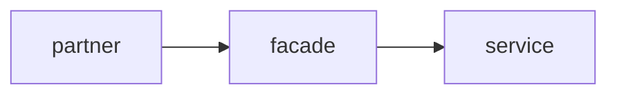
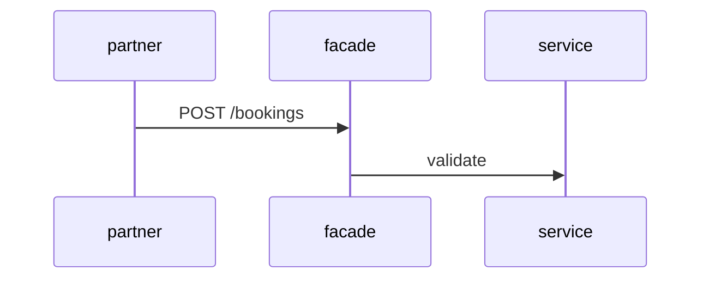

# Slide show

Summarize a topic as a short presenterm deck, draw its structure as
diagrams, and open it where the user can page through it.

A deck beats a long chat answer when the user wants to see the shape of
something (a flow, an architecture, a before/after, a set of options) or to
show it to someone else. It costs little to make, so offer one when a
summary would otherwise be a wall of text.

## 1. Gather and plan

- Read the material first: the files, PR, docs or conversation the topic
  comes from. A deck that summarizes something you haven't read is
  decoration.
- Aim for 5 to 10 slides. One idea per slide; the title states the point
  ("Bookings fail before validation", not "Validation").
- Plan which slides get a diagram. A diagram earns its slide when it shows
  relationships the bullets can't: a flow, a sequence between systems, a
  state machine, a dependency graph, a timeline.
- Typical arc: title, the problem or question, how it works (diagram),
  the key findings or options, a comparison, the decision or next step.

## 2. Write the deck

Put the deck in a folder of its own: the scratchpad for a throwaway, or a
path the user names. presenterm resolves image paths relative to the deck,
so any images go next to it.

```markdown
---
title: Booking validation
sub_title: Why partner bookings fail before they reach validation
---

The flow today
===



<!-- end_slide -->

Two options
===

<!-- column_layout: [1, 1] -->

<!-- column: 0 -->
**Validate in the facade**
* one place to change
* adds latency to every call

<!-- column: 1 -->
**Validate in the service**
* keeps the facade thin
* duplicated rules

<!-- reset_layout -->
```

- `===` under a line makes it the slide title; `<!-- end_slide -->` ends
  a slide.
- `<!-- pause -->` reveals the rest of a slide on the next key press.
- `<!-- column_layout: [1, 1] -->`, `<!-- column: N -->` and
  `<!-- reset_layout -->` put things side by side.
- `` sizes an image to a share of the width.
- Keep each slide to what fits on one screen: about 6 bullets, short lines.
  Code blocks get a language tag for highlighting; keep them under ~15 lines.

The user's presenterm config (`~/.config/presenterm/config.yaml`, from the
dotfiles) sets the `catppuccin-mocha` theme, so don't pass `--theme`.

## 3. Draw the diagrams

**Write diagrams as `mermaid +render` blocks in the deck.** presenterm
renders each one to an image when it loads the deck, by calling `mmdc`
(mermaid-cli, which drives a headless Chrome through puppeteer):

````markdown

````

- `+width:N%` sizes the image on the slide.
- The first render of a block takes a second or two while Chrome starts.
  presenterm caches the result, so reloads stay fast until the block changes.
- A block with a syntax error shows the error on the slide. Fix it in the
  deck and the open pane re-renders it.

mermaid-cli is pinned to 11.15.0 in the global mise config; the comment
there says why. Don't upgrade it or override its trust check to get a newer
Mermaid.

## 4. Check the deck

- `presenterm --validate-overflows deck.md` reports slides that don't fit
  the terminal. Use it in the pane the deck will be shown in, since the
  result depends on that pane's size.
- `presenterm -E deck.md` exports HTML and `-e` exports PDF, for sharing.
  Both need a real terminal (they query it), so run them in a pane too.
- Never pass `-x` or `-X`: they execute code snippets from the deck.

## 5. Show it

The deck needs a real terminal of its own; a tool call's output can't page
through slides. Open it in a pane next to the conversation, keep the focus
where the user is typing, and tell them the keys: `→`/`l` next slide,
`←`/`h` previous, `gg` first, `G` last, `ctrl+p` slide index, `q` quits.
Leave out `-p`/`--present`: presentation mode turns off the hot reload that
step 6 relies on.

Check which multiplexer you are in, in this order:

| Check | Where | Open the deck |
|---|---|---|
| `TUIOS_ENV=1` | tuios | `tuios new-window -s "$TUIOS_SESSION" slides --cwd "$DECK_DIR" --no-focus -- presenterm deck.md` |
| `REX_SESSION` set | Rex | Load the `rex` skill and open a pane beside yours running `presenterm deck.md` in the deck's folder. |
| `HERDR_ENV=1` | herdr | `herdr pane split --current --direction right --cwd "$DECK_DIR" --no-focus`, then `herdr pane run <pane> "presenterm deck.md"` with the pane id it returns. |
| none of these | plain terminal | Give the user the command to run, with `!` in front if they want it in this session's terminal. |

Every one of these commands asks the user for approval: the
`pane-control-guard` hook prompts for anything that launches, types into or
reads from a pane. That is intended, so don't route around it with a script,
a different CLI or the socket; say what the pane will run and wait.

Rex and tuios panes also set `HERDR_ENV=1` without a herdr server, so check
`TUIOS_ENV` and `REX_SESSION` before trusting `HERDR_ENV`. For details on
each tool (closing panes, other layouts), load the `tuios`, `rex` or `herdr`
skill.

Images need a terminal graphics protocol. presenterm detects one on its own;
if the diagrams come out as coloured blocks, the pane isn't passing kitty
graphics through. Try `--image-protocol kitty-local` once, then fall back to
telling the user the deck looks right in a plain Ghostty tab.

## 6. Iterate

presenterm reloads the deck when the file changes, so edit `deck.md` in
place; the open pane picks it up. Don't open
a second pane for the same deck. Close only panes you opened.
